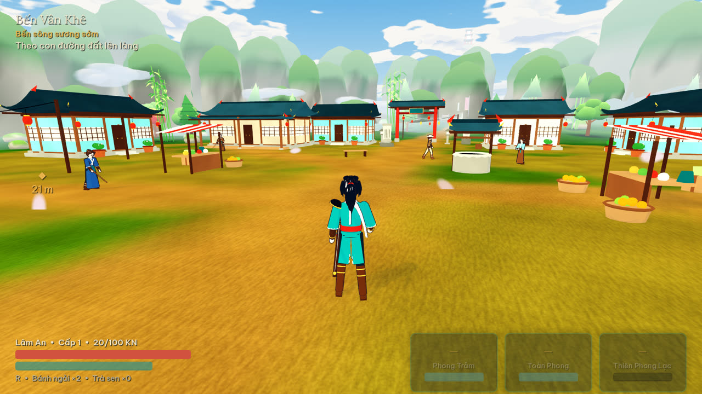

# Vân Khê — Dư Âm Gió

Game nhập vai hành động góc nhìn thứ ba, một người chơi, phong cách anime pha võ hiệp. Do Nguyễn Thành Long sáng tác; chạy bằng **Godot 4.7.2 + GDScript** (renderer GL Compatibility), model và animation dựng bằng **Blender**.

Lâm An, kiếm khách trẻ mang thanh kiếm cũ, cập bến thung lũng Vân Khê — nơi người làng đang quên dần người thân và mỗi chiều có hồi chuông vọng từ núi. Lần theo những ký ức còn vương trong gió, Lâm An đi qua làng, Đồi Gió, rừng Trúc Hải và Khe Gió để tìm ra điều gì đang nằm dưới Đền Tịch Phong.



**Trạng thái:** đoạn chơi mẫu (vertical slice) Chương I — Hồi 1 và 2, khoảng 20–30 phút: 4 nhiệm vụ chính, 2 nhiệm vụ phụ, 2 sự kiện, 2 loại địch thường, miniboss Trúc Tướng, hệ chiến đấu đầy đủ (trạng thái, buff/debuff, Ngọc bội, phản ứng nguyên tố, kết liễu, Tâm Nhãn), lưu game, nhạc/âm thanh, giao diện tiếng Việt. Hồi 3 chưa làm; đang mở rộng thành Chương I hoàn chỉnh theo 6 giai đoạn (xong giai đoạn 1). Chi tiết: [tiến độ](docs/progress.md), [thiết kế](docs/game-design.md).

## Chơi trên Windows

Yêu cầu: Windows 10/11 64-bit, GPU hỗ trợ OpenGL 3.3.

**Từ bản build:** giải nén thư mục `VanKhe` (gồm `VanKhe.exe` và `VanKhe.pck` — hai file phải nằm cùng chỗ), chạy `VanKhe.exe`. Save và thiết lập nằm trong `%APPDATA%\Godot\app_userdata\Vân Khê — Dư Âm Gió\`.

**Từ mã nguồn:**

```powershell
git clone https://github.com/longnt284/Game_Openworld.git
cd Game_Openworld
./tools/setup.ps1          # tải Godot 4.7.2 chính thức, kiểm tra SHA-256
./tools/run.ps1            # chạy game
./tools/run.ps1 -Mode editor
```

Nếu PowerShell chặn script, dùng `powershell -ExecutionPolicy Bypass -File .\tools\setup.ps1` cho lần gọi đó. Đã có Godot đúng phiên bản thì truyền `-GodotPath 'C:\đường\dẫn\godot_console.exe'`. Blender không cần để chơi: GLB đã nằm trong repo.

## Điều khiển (đổi được trong Thiết lập)

| Phím | Thao tác |
|---|---|
| WASD, chuột | Di chuyển, xoay camera |
| Chuột trái | Chuỗi 3 đòn; giữ 0,4 s: trọng kích |
| Chuột phải | Đỡ; bấm đúng lúc đòn tới: phản đòn |
| Shift | Né (bấm), chạy nhanh (giữ) |
| Space | Nhảy; trên không: khinh công; giữ khi rơi: lướt gió |
| E / Q | Phong Trảm / Toàn Phong (sau khi lĩnh hội) |
| F | Nói chuyện, mở rương, thắp miếu…; cạnh địch đã phá thế: kết liễu |
| R | Dùng thuốc hồi máu |
| C | Dùng vật phẩm ở ô nhanh (chọn trong Túi đồ) |
| Chuột giữa / T | Khóa mục tiêu |
| M / J / I | Bản đồ / Nhật ký / Túi đồ |
| F5 / F9 | Lưu / Tải nhanh |
| F3 | Bật/tắt bảng thông số kỹ thuật |
| Esc | Tạm dừng |

Game tự lưu khi thắp Miếu Gió, vào vùng mới, hoàn thành nhiệm vụ, sau các mốc lớn (giải đố chuông, hạ boss) và mỗi 5 phút khi không chiến đấu. Màn hình chính có "Tiếp tục hành trình" khi đã có save.

## Đóng gói bản Windows

```powershell
./tools/setup.ps1 -WithExportTemplates   # tải export template 4.7.2 (kiểm tra SHA-512), chỉ giải nén bản Windows x86_64
./tools/run.ps1 -Mode export             # tạo build/windows/VanKhe.exe + VanKhe.pck
```

Bản xuất gồm toàn bộ dữ liệu, model, nhạc và font; không gồm `tests/`, `tools/`, `docs/`. Ghi công và giấy phép (Godot MIT, font OFL, âm thanh CC0) có trong game ở mục **Ghi công** và trong [docs/credits.md](docs/credits.md).

## Phát triển và kiểm tra

```powershell
./tools/run.ps1 -Mode test      # import + smoke test + gameplay test (chạy trọn slice)
./tools/run.ps1 -Mode preview   # chụp ảnh các cảnh và đo thời gian khung hình (cần GPU, không headless)
```

Trên Linux/macOS dùng `tools/run.sh` (đặt biến `GODOT` trỏ tới Godot 4.7.2). CI GitHub Actions chạy chế độ `test` trên Windows.

| Thư mục | Nội dung |
|---|---|
| `scripts/` | Mã game (người chơi, chiến đấu, địch, thế giới, nhiệm vụ, UI, âm thanh, lưu game) |
| `data/` | Nhiệm vụ, hội thoại, vật phẩm, địch, thời điểm animation; `data/world/` bố cục bản đồ, thực thể, đạo cụ |
| `assets/models/` | GLB dùng trong game · `art/` file `.blend` nguồn |
| `assets/audio/` | Nhạc, hiệu ứng, âm nền (OGG) |
| `tools/blender/`, `tools/audio/` | Script tái tạo model/animation và âm thanh |
| `tests/` | Smoke test, gameplay test, chụp ảnh render |

Tài liệu: [kiến trúc](docs/architecture.md) · [pipeline Blender](docs/blender-pipeline.md) · [danh mục asset](docs/assets.md) · [kết quả kiểm tra](docs/validation.md) · [ghi công](docs/credits.md) · [lựa chọn thư viện](docs/dependency-decisions.md).
