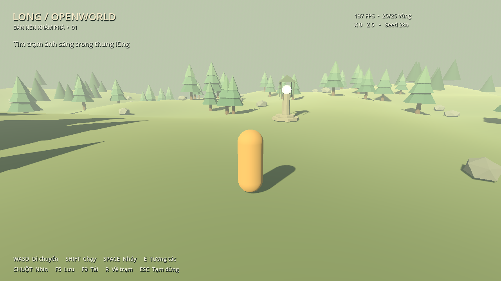

# Game_Openworld
Game thế giới mở do Nguyễn Thành Long sáng tác

Bản nền 3D chạy bằng **Godot 4.7.2 + GDScript**, dùng model tạo bằng **Blender**. Có nhân vật góc nhìn thứ ba, chạy/nhảy, camera tránh vật cản, địa hình theo seed tải từng vùng, cây/đá, trạm checkpoint, tạm dừng và lưu/tải hành trình.



## Chạy trên Windows

Yêu cầu: Windows 10/11 64-bit, PowerShell, Git và GPU hỗ trợ Godot GL Compatibility. Blender không bắt buộc để chơi vì GLB đã có trong repo.

```powershell
git clone https://github.com/longnt284/Game_Openworld.git
cd Game_Openworld
./tools/setup.ps1 -WithStudioReference
./tools/run.ps1 -Mode editor
```

Trong Godot nhấn **F6/F5** để chạy scene/project. Hoặc chạy trực tiếp bằng `./tools/run.ps1`. Nếu PowerShell chặn script tải từ Internet, dùng `powershell -ExecutionPolicy Bypass -File .\tools\setup.ps1` cho lần gọi đó, không cần đổi policy toàn hệ thống.

`setup.ps1` tải Godot bản chính thức có kiểm tra SHA-256 vào `.tools/godot`. Tham số `-WithStudioReference` thêm repo tham khảo Game Studios ở commit cố định; có thể bỏ qua để chỉ cài engine. Xem [lý do chọn/bỏ từng repo](docs/dependency-decisions.md).

Máy có sẵn Godot đúng phiên bản có thể mở `project.godot` hoặc truyền `-GodotPath 'C:\path\godot_console.exe'` cho `run.ps1`. macOS/Linux có thể dùng Godot 4.7.2 chính thức mở project và chạy các lệnh headless bên dưới; chưa có script cài tự động hoặc kiểm tra render cho hai nền tảng này.

## Điều khiển

| Phím | Thao tác |
|---|---|
| WASD / chuột | Di chuyển / nhìn quanh |
| Shift / Space | Chạy nhanh / nhảy |
| E | Kích hoạt trạm ánh sáng khi ở gần |
| R | Về checkpoint (hoặc điểm xuất phát) |
| F5 / F9 | Lưu / tải hành trình khi đang chơi |
| Esc | Tạm dừng, mở menu và thả chuột |

Đi về phía trạm đèn trước mặt để kích hoạt checkpoint, sau đó khám phá địa hình. Save nằm trong thư mục `user://` của Godot, ngoài repo. Game không tự tải save khi khởi động; nhấn F9 để tiếp tục.

## Phát triển và kiểm tra

```powershell
./tools/run.ps1 -Mode test
blender --background --factory-startup --python tools/blender/build_assets.py
```

Các lệnh tương đương khi Godot đã ở PATH:

```sh
godot --headless --path . --editor --import
godot --headless --render-thread safe --path . --script res://tests/smoke_test.gd
```

CI chạy import và smoke test trên Windows: asset GLB, collision, movement/jump, pause, chunk streaming/reuse, khớp mép địa hình, checkpoint, save round-trip và phục hồi file hỏng. Xem [kiến trúc](docs/architecture.md), [pipeline Blender](docs/blender-pipeline.md) và [kết quả kiểm tra](docs/validation.md).

Điều chỉnh seed, tốc độ và ngân sách vùng ở `config/default_settings.tres`. Thư mục `art/` chứa nguồn Blender; `assets/models/` chứa GLB dùng trong game. Đây là base để phát triển tiếp, với nhân vật capsule và bộ model mẫu; các hệ combat, inventory, AI, quest, multiplayer và bản phát hành đóng gói chưa nằm trong phạm vi này.
