# Kiểm chứng bản nâng cấp hình ảnh

Bản này đã qua prototype Lâm An + làng nhỏ trước khi xuất lại toàn bộ 76 asset đang dùng. Scene review: `scenes/tests/roblox_art_review.tscn`.

## Ảnh trong game

Ảnh chụp từ Godot, không phải concept render. Camera và thời tiết cố định; hoạt ảnh NPC và hạt vẫn chạy. Ảnh gameplay có kích thước thực 1875 × 1055 do giới hạn cửa sổ trên máy chụp.

| Khu vực | Trước | Sau |
|---|---|---|
| Làng ban ngày | 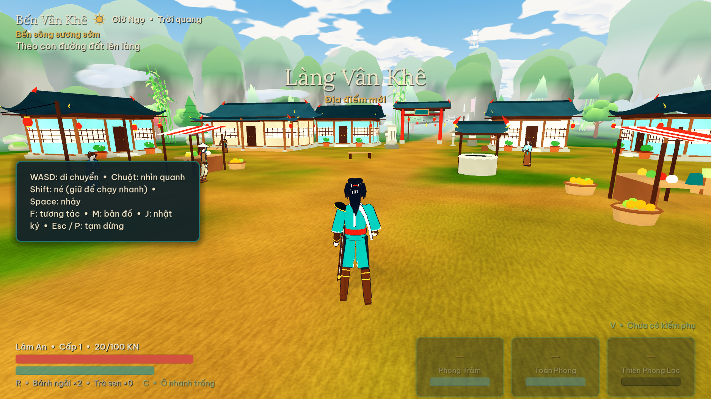 | 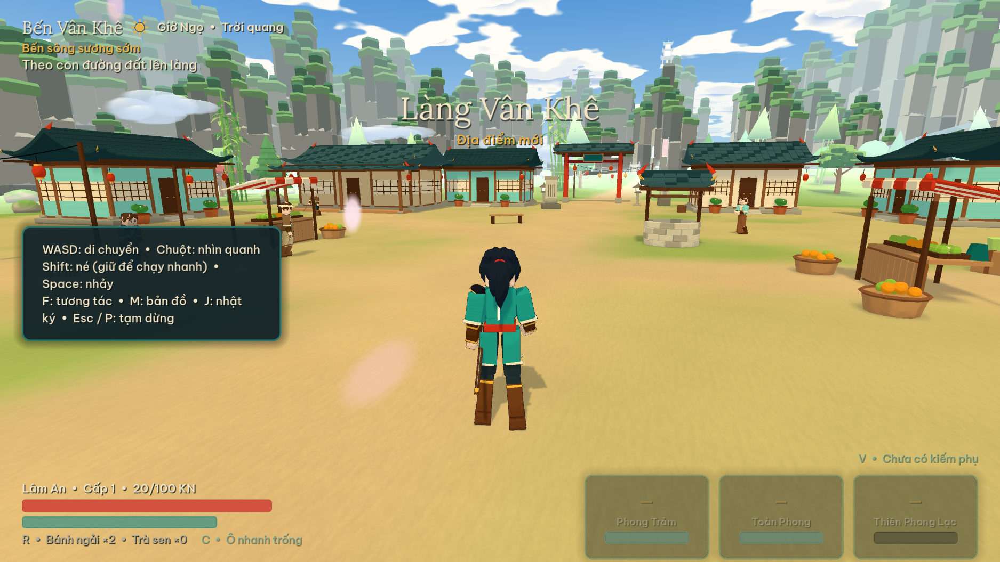 |
| Làng chiều | 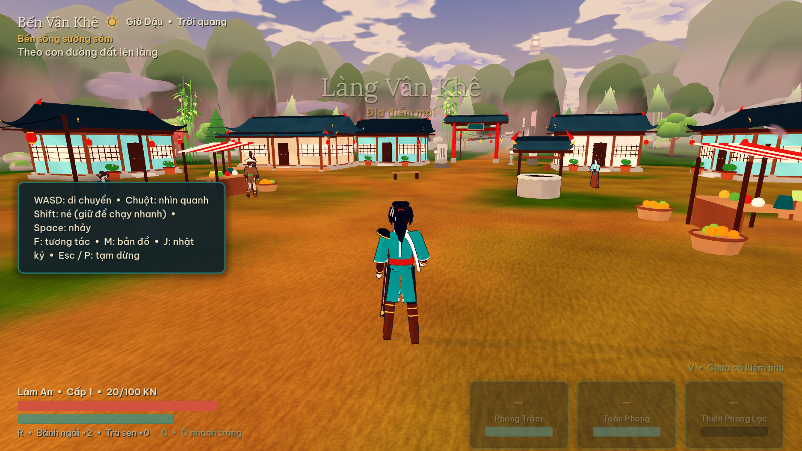 | 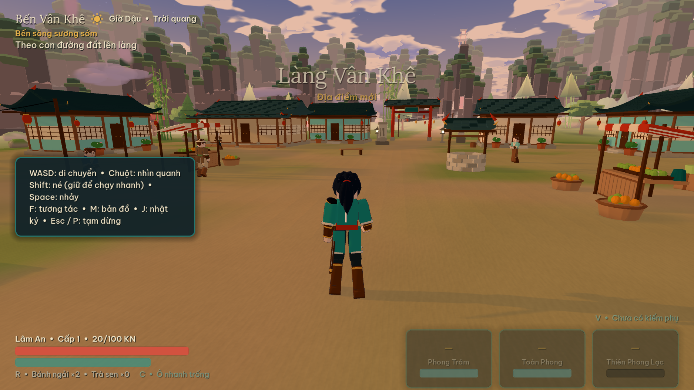 |
| Rừng trúc | 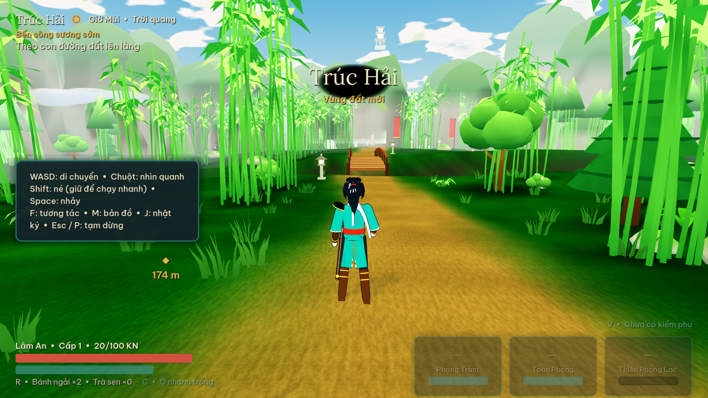 | 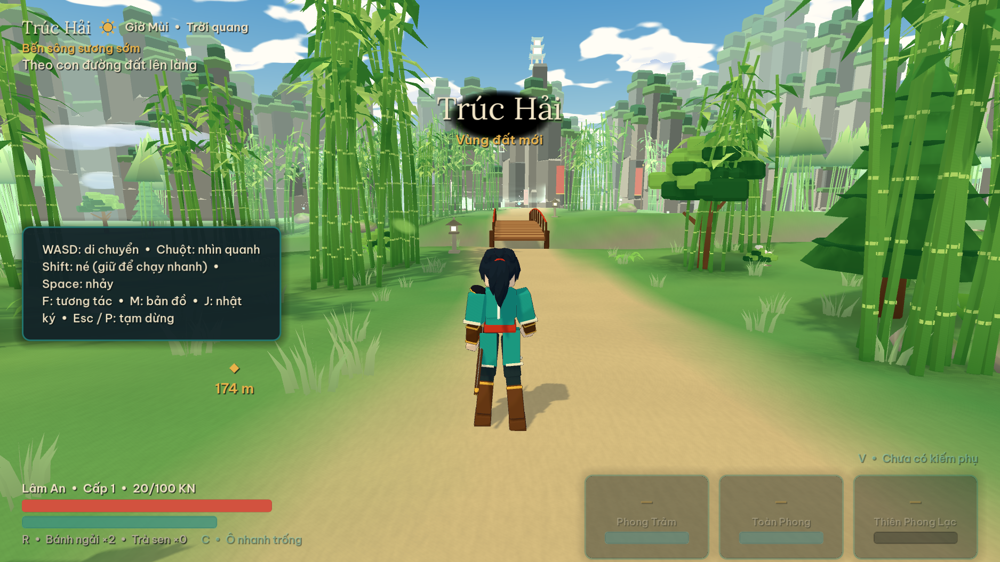 |
| Hẻm núi | 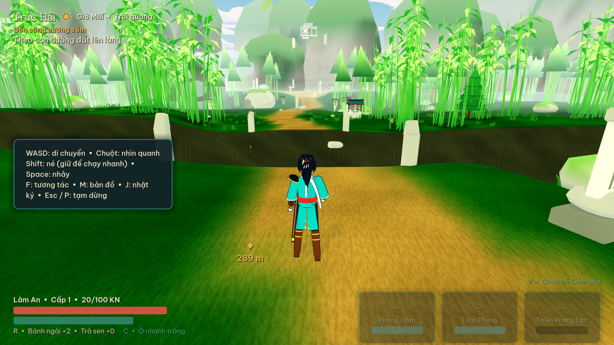 | 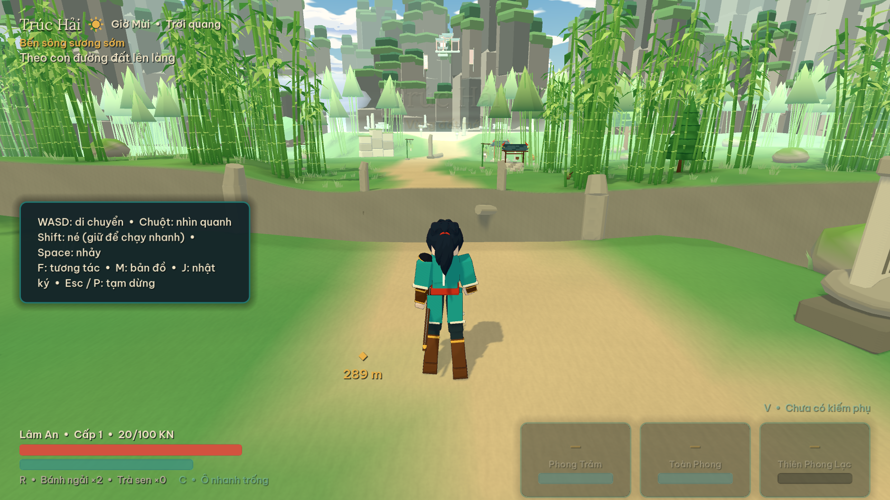 |
| Boss | 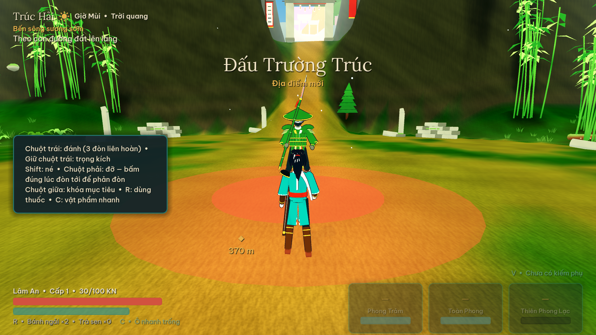 | 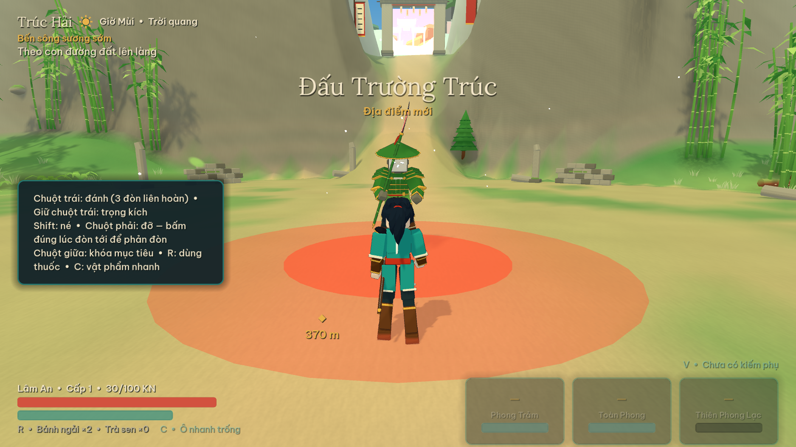 |

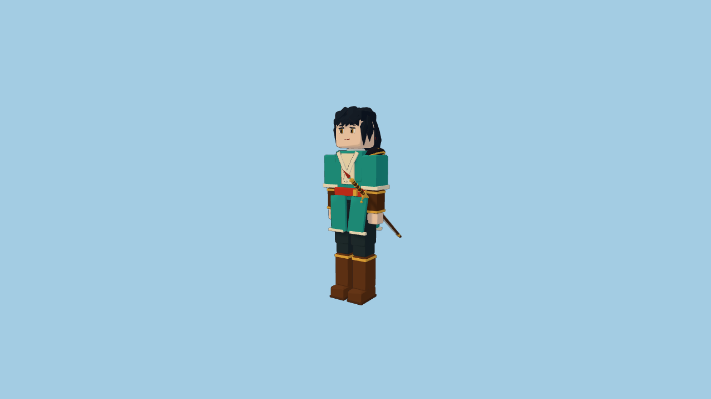

Thư mục `visual-upgrade/prototype/` có đủ mặt trước/sau/bên và các pose run, dodge, block, attack_2, skill_cyclone, air_leap, glide.

## Kiểm tra

- Godot 4.7.2: smoke, gameplay, combat, progression và world đều đạt; tổng 449 kiểm tra. World được chạy lại sau khi khôi phục công thức ambient theo contract cũ.
- `python tests/art_contract.py`: 76 asset thay đổi, 0 lỗi. So với commit `08d13b7`: tên và track animation, thời điểm/pose, joint, inverse bind matrix và collider không đổi; vị trí hữu hạn, trọng số skin hợp lệ, scale dương.
- Có thể truyền commit nền khác: `python tests/art_contract.py <base-ref>`.
- Capture: `godot --path . --resolution 1920x1080 --script res://tests/render_preview.gd -- village_day village_dusk bamboo gorge boss`.
- Review pose: `godot --path . --resolution 1280x720 res://scenes/tests/roblox_art_review.tscn -- --capture`.

## Hiệu năng đo tại máy

Godot 4.7.2, Compatibility/OpenGL 3.3, NVIDIA RTX 3050 Ti Laptop, driver 581.57, preset medium. Kích thước thực **1920 × 1055**, dù yêu cầu 1920 × 1080; không gọi đây là phép đo 1080p. Đo thời gian giữa frame, không phải GPU timer. VSync khoảng 144 Hz giới hạn nhiều cảnh; mỗi lượt chỉ 180–420 frame, chưa thay thế kiểm thử dài trên máy yếu.

| Cảnh | Frame | FPS trung bình | p95 (ms) | Draw call tối đa |
|---|---:|---:|---:|---:|
| Làng | 300 | 144,0 | 8,46 | 400 |
| Cầu rừng trúc | 300 | 144,1 | 8,54 | 284 |
| Di chuyển hẻm núi | 180 | 144,0 | 8,15 | 282 |
| Chuyển vùng | 420 | 144,0 | 9,05 | 350 |
| Combat boss | 420 | 125,0 | 8,19 | 318 |

Bộ nhớ static cao nhất 106,6 MB; video memory do Godot báo cao nhất 85,7 MB. Không có số đo trước nâng cấp tương đương để kết luận tăng tốc. Xem [phạm vi và giới hạn](roblox-art-direction.md) trước khi đánh giá mức bám concept.
